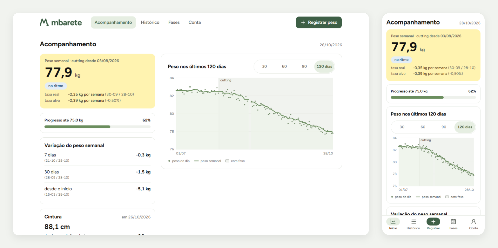
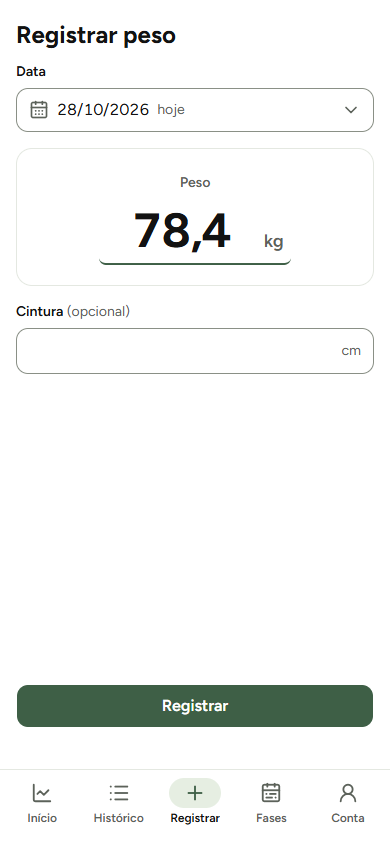
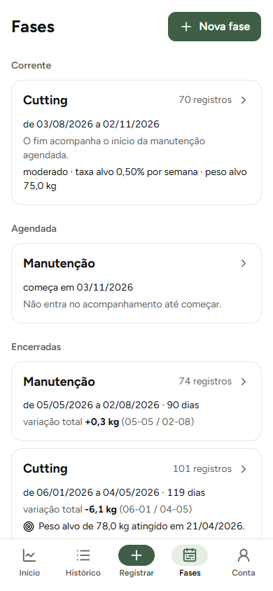
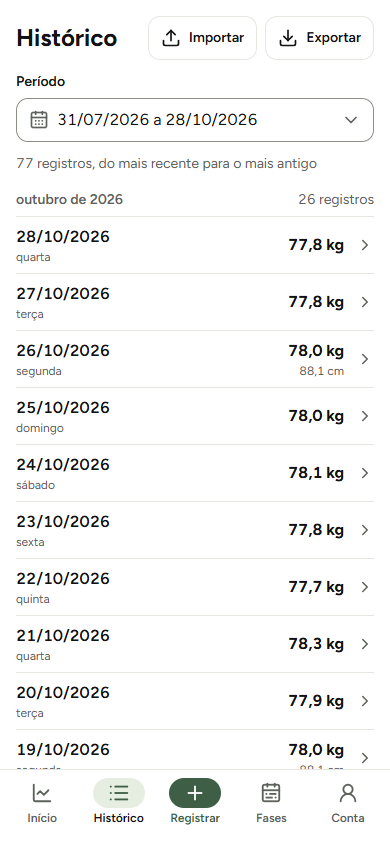
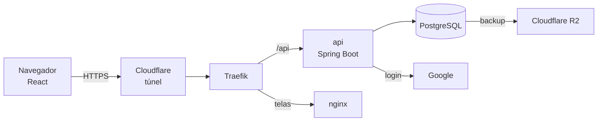

# Mbarete

**Estou no ritmo do meu ciclo?** O Mbarete acompanha o peso de quem treina em
ciclos de cutting, bulking e manutenção, e responde a essa pergunta pelo
**peso semanal**, a média dos últimos 7 dias, e nunca pelo peso de um dia.



## Por que o peso semanal

O peso de um dia oscila um a dois quilos com água e sal, e decisão tomada em
cima disso é decisão tomada em cima de ruído. Por isso o veredito, a barra de
progresso e as variações saem sempre do peso semanal. O gráfico mostra os
dois: o peso do dia em pontos e o semanal em linha.

## O que ele faz

- **Registra o peso do dia** em uma tela, com a cintura opcional.
- **Diz se a fase está no ritmo**: abaixo, dentro ou acima da taxa planejada,
  com a taxa real ao lado. Na manutenção, se o peso está dentro da faixa de 1%
  em volta do peso de partida.
- **Mostra o progresso** até o peso alvo e avisa quando ele é atingido.
- **Organiza as fases**: a corrente, as agendadas e as encerradas, com o
  histórico de cada uma.
- **Importa e exporta CSV**, com pré-visualização antes de gravar qualquer
  linha.
- **Entra pelo Google, por convite**, sem senha própria.

| Registrar | Fases | Histórico |
|:--:|:--:|:--:|
|  |  |  |

## Arquitetura

O navegador conhece um endereço só: o túnel da Cloudflare leva a requisição
ao servidor de casa, sem nenhuma porta aberta, e o Traefik separa a api das
telas. O banco só é alcançável pela api.



| Parte | Tecnologia | Decisões |
|:--|:--|:--|
| Frontend | React com Vite e TypeScript, TanStack Query, React Hook Form com Zod, Tailwind com shadcn/ui, Recharts | [0002](especificacao/adr/ADR-0002-frontend-react-vite-typescript.md), [0023](especificacao/adr/ADR-0023-tanstack-query.md), [0026](especificacao/adr/ADR-0026-react-hook-form-zod.md), [0028](especificacao/adr/ADR-0028-tailwind-shadcn.md), [0029](especificacao/adr/ADR-0029-recharts.md) |
| Backend | Java 25, Spring Boot 4.1, Spring Data JPA, Flyway | [0035](especificacao/adr/ADR-0035-backend-spring-boot.md), [0036](especificacao/adr/ADR-0036-spring-data-jpa.md), [0040](especificacao/adr/ADR-0040-flyway-antes-da-api.md) |
| Banco | PostgreSQL | [0004](especificacao/adr/ADR-0004-postgres.md), [0039](especificacao/adr/ADR-0039-postgres-com-cloudnativepg.md) |
| Identidade | Google, entrada por convite, JWT em cookie | [0008](especificacao/adr/ADR-0008-identidade-google.md), [0011](especificacao/adr/ADR-0011-entrada-por-convite.md), [0041](especificacao/adr/ADR-0041-jwt-em-cookie.md) |
| Produção (próxima etapa) | k3s numa VM do Proxmox, Traefik, Cloudflare Tunnel, CloudNativePG | [0006](especificacao/adr/ADR-0006-hospedagem-servidor-proprio.md), [0037](especificacao/adr/ADR-0037-kubernetes-com-k3s.md), [0038](especificacao/adr/ADR-0038-entrada-pelo-traefik.md) |
| Qualidade | Spotless, Error Prone com NullAway, JUnit com Testcontainers e ArchUnit, Vitest, GitHub Actions | [0020](especificacao/adr/ADR-0020-teste-em-tres-camadas.md), [0042](especificacao/adr/ADR-0042-spotless-error-prone-nullaway.md) |

## Como foi feito

- **Especificação antes do código.** 64 regras de negócio, 48 requisitos
  funcionais, 14 casos de uso e 29 requisitos não funcionais, cada um com um
  identificador estável, citado entre documentos. Dezesseis defeitos de
  coerência foram achados nela, e nenhum lendo um documento sozinho: todos
  apareceram com dois documentos lado a lado.
- **42 decisões registradas, cada uma com a alternativa recusada.** Onze foram
  superadas e continuam no repositório, com o motivo da troca: o backend
  começou em FastAPI e foi para Spring Boot.
- **Regra de negócio sem framework.** O peso semanal, o ritmo e o progresso
  são funções puras, que recebem listas e devolvem valores. O ArchUnit impede
  que elas importem Spring ou JPA.
- **Um contrato só entre as pontas.** O backend publica o OpenAPI, e os tipos
  do frontend são gerados dele. O front confere a forma do que se digita, e a
  regra fica no backend.
- **Testes que provam o que dizem.** Cada teste diz, num comentário, o defeito
  que pega, e foi conferido contra uma versão quebrada de propósito. A
  integração contínua roda tudo a cada push.
- **Peso exato e data sem fuso.** `BigDecimal` e `numeric(4,1)`, nunca
  `double`; o dia corrente vem do aparelho de quem registra.

## Rodar na máquina

Requisitos: Java 25, Node 22 e Docker.

```bash
# 1. Configuração: copie e preencha; cada variável está explicada no arquivo.
#    A chave do token:
#    openssl genpkey -algorithm RSA -pkeyopt rsa_keygen_bits:2048 | openssl pkcs8 -topk8 -nocrypt -outform DER | base64 -w0
cp backend/.env.example backend/.env

# 2. Banco de desenvolvimento
docker compose -f compose.dev.yml --env-file backend/.env up -d

# 3. Migrações e o convite do seu e-mail, porque a entrada é por convite
cd backend
./mvnw package -DskipTests
java -jar target/api-0.0.1-SNAPSHOT.jar migrar
java -jar target/api-0.0.1-SNAPSHOT.jar convidar voce@exemplo.com

# 4. A api
./mvnw spring-boot:run

# 5. As telas, noutro terminal, em http://localhost:5175
cd frontend
npm install
npm run dev
```

O login pede um cliente OAuth do Google com o endereço de retorno
`http://localhost:5175/api/v1/auth/callback`.

Testes: `./mvnw verify` no backend (o Testcontainers sobe um Postgres no
Docker) e `npm test` no frontend.

## Estado

As telas e a api estão prontas e em uso. A produção, com o k3s no servidor, o
túnel, o backup e o deploy com ensaio, é a próxima etapa.

## Documentação

- [Especificação](especificacao/): regras, requisitos e casos de uso
- [Decisões de arquitetura](especificacao/adr/)
- [Arquitetura](especificacao/arquitetura.md)
- Convenções do [backend](especificacao/convencoes-backend.md) e do
  [frontend](especificacao/convencoes-frontend.md)
- [Fluxo de trabalho](especificacao/fluxo-de-trabalho.md)

Todos os direitos reservados.
