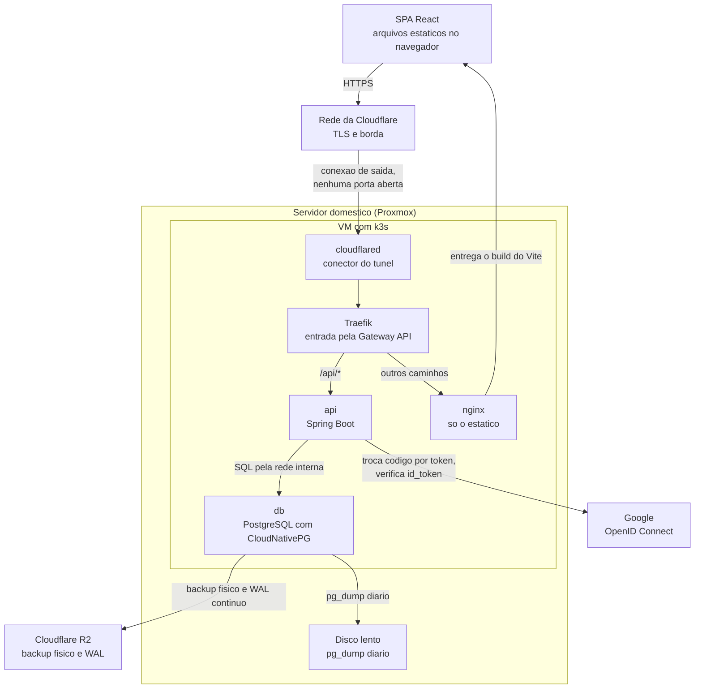

# Arquitetura

Duas vistas do modelo C4, contexto e contêiner, mais a regra de dependência
interna. Os níveis 3 e 4 do C4 não estão aqui, e o motivo está no fim.

## Nível 1: contexto

Quem usa o sistema e com que sistema externo ele conversa.


O AT-02 aparece com seta para o sistema mesmo sem ter interface: ele age pelo
terminal do servidor e pelo console do Google, não por tela (`atores.md`).

Não há nenhum outro sistema externo. Não existe serviço de e-mail, nem passarela
de pagamento, nem integração com balança ou aplicativo de terceiro.

## Nível 2: contêineres

O que roda onde, e por onde a requisição passa.



| Contêiner | Responsabilidade | Decisão |
|:--|:--|:--|
| SPA React | telas, estado de tela, validação de forma | ADR-0002, ADR-0025 |
| cloudflared | publica o serviço sem abrir porta na casa | ADR-0006 |
| Traefik | recebe toda requisição e repassa por caminho | ADR-0038 |
| nginx | entrega o estático | ADR-0038 |
| api | regras de negócio, contrato de API, autenticação | ADR-0035, ADR-0041 |
| db | dado, restrições de integridade, backup | ADR-0004, ADR-0005, ADR-0039 |

Tudo dentro da VM roda no k3s (ADR-0037). O initContainer da migração e o Job
do ensaio (ADR-0040) não aparecem: são passos que terminam, e não serviços no
ar. O initContainer roda a cada subida do Pod da api e aplica o que estiver
pendente no banco.

Três propriedades que essa vista fixa, e que valem mais que o desenho:

**Origem única.** O navegador conhece um endereço só. Isso apaga a configuração
de origem cruzada, deixa o cookie funcionar sem marca especial, e faz existir
um único URI de redirecionamento no Google (ADR-0038, ADR-0041).

**O banco não é alcançável de fora.** Ele existe apenas na rede interna do
cluster, e nenhum caminho do diagrama chega nele sem passar pela api (RNF-20).

**Nenhuma porta aberta na casa.** A seta da Cloudflare para o `cloudflared`
aponta no sentido do desenho, mas a conexão é estabelecida de dentro para fora
(RNF-19).

## A regra de dependência interna

Em vez das camadas completas de Clean Architecture, uma regra só (ADR-0019):

> O módulo de regras de agregação não importa Spring nem JPA.

Traduzida em estrutura de pasta do backend:

```
src/main/java/.../
  controller/   Spring MVC: recebe, chama o service, devolve DTO
  service/      abre a transação, chama repository e regras
  repository/   Spring Data JPA: as consultas
  entity/       JPA: as tabelas
  dto/          records: entrada e saída de cada rota
  mapper/       conversão entre entidade e DTO, escrita à mão
  exception/    tratamento global de erro
  config/       segurança e configuração
  regras/       nao importa nada alem da biblioteca padrao do Java
src/main/resources/db/migration/   as migrações SQL do Flyway
```

A direção é sempre a mesma: **todos podem importar `regras/`, e `regras/` não
importa ninguém.** Ela recebe listas de dados e devolve valores.

Três regras concretas que vêm da mesma família:

- O controller não calcula nada. Ele chama quem calcula.
- A função de regra recebe dados, não o repositório.
- O banco só é consultado dentro do service (ADR-0036).

**Como isso se verifica em vez de se prometer:** um teste de arquitetura com o
ArchUnit, uma biblioteca de teste que confere quem importa quem: nenhuma classe
de `regras/` importa `org.springframework` ou `jakarta.persistence`, e nenhum
controller usa repository direto. Roda em milissegundos, e falha no dia em que
alguém tomar o atalho. Sem ele, a regra é comentário.

O retorno concreto: os testes de peso semanal, taxa real, veredito e progresso
rodam sem banco e sem servidor, que é o que torna a RNF-27 barata em vez de
cerimonial (ADR-0020).

## Os níveis 3 e 4 do C4 não estão aqui

O C4 tem quatro níveis: contexto, contêiner, componente e código. Os dois
primeiros estão acima. Os dois últimos foram recusados, com motivo.

**Componente** desenharia as peças dentro da api. A estrutura de pasta acima já
diz isso em poucas linhas, e um diagrama de componente fica desatualizado no
primeiro refactor, porque descreve exatamente o que mais muda.

**Código** desenharia classes e funções. Isso é o código, e o código é a única
descrição dele que não pode divergir dele.

A pergunta que decide se um diagrama vale: ele mostra algo que não se descobre
lendo a pasta? Contexto e contêiner mostram (o túnel de saída, a origem única, o
banco isolado, o que é externo). Componente e código não.
